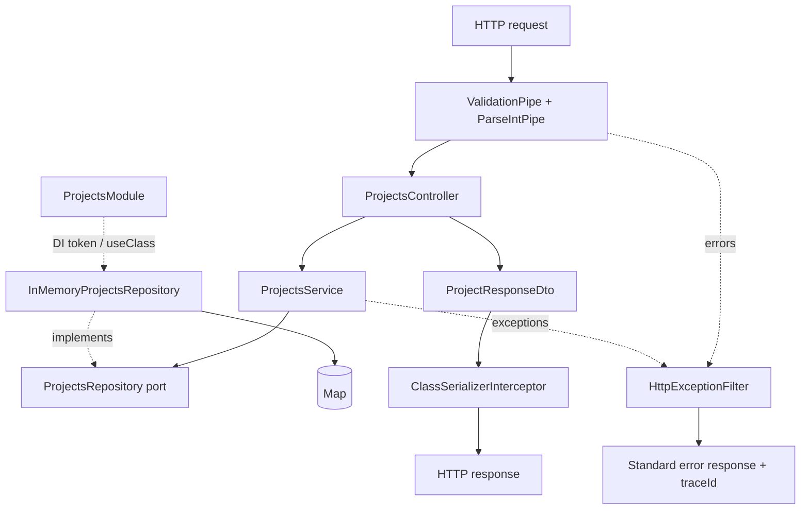

# ПР 4. Валідація, трансформація, серіалізація та помилки API

Оновлено наявні `ProjectsModule`, `ProjectsController`, `ProjectsService` і repository port. Другий модуль, контролер або сервіс Projects не створювалися; назву npm-пакета збережено.

## Запуск

Потрібні Node.js 20+ та npm. У терміналі:

```
Set-Location C:\ПР4
npm ci
npm run build
npm start
```

API: `http://localhost:3000/projects`. Змінна `PORT` задає інший порт.
`npm run start:dev` запускає TypeScript напряму.
ПР4 за замовчуванням використовують той самий порт, тому запускайте один сервер або задайте інший `PORT`.

## Вхідні DTO

| Поле | POST /projects | PATCH /projects/:id |
| --- | --- | --- |
| name | Обов’язковий рядок, 3–100 символів | Необов’язковий, ті самі перевірки |
| description | Необов’язковий рядок, до 500 символів | Необов’язковий, ті самі перевірки |
| status | Обов’язкове значення draft, active або completed | Необов’язкове, ті самі значення |

Крайні пробіли назви прибираються через `@Transform` перед перевіркою довжини. Числа не перетворюються на рядки: `name: 123` відхиляється. Переданий `null` також відхиляється; необов’язковість означає відсутність поля. Невідомі поля повертають 400.

Опис за замовчуванням — порожній рядок. Сервіс обрізає його крайні пробіли; `description: ""` очищає опис. PATCH зберігає непередані поля. З ПР3 збережено правило: порожній PATCH `{}` для наявного проєкту повертає 400 `EMPTY_UPDATE`.

Назви унікальні після обрізання крайніх пробілів, з урахуванням регістру: `StudyFlow` та `studyflow` — різні назви. Перевірка виконується в сервісі. Repository adapter також атомарно захищає унікальність під час запису, щоб одночасні запити не створювали дублікати; помилка port перетворюється сервісом на 409.

## Серіалізація

Приклад POST:

```json
{
  "name": "StudyFlow",
  "description": "Система керування навчальними проєктами",
  "status": "active"
}
```

Приклад відповіді 201 (ID та час генеруються сервером):

```json
{
  "id": 1,
  "name": "StudyFlow",
  "description": "Система керування навчальними проєктами",
  "status": "active",
  "createdAt": "2026-09-23T10:00:00.000Z"
}
```

`ProjectResponseDto` має `@Exclude()` на класі та `@Expose()` лише для цих п’яти полів. Контролер виконує тільки HTTP-адаптацію: приймає DTO/ID, викликає сервіс і перетворює результат на DTO через `plainToInstance`. Глобальний interceptor серіалізує DTO. `updatedAt`, `internalNote`, `deletedAt` та інші поля repository не потрапляють до клієнта. Це застосовано до POST, GET одного запису, GET списку й PATCH.

## CRUD API

| Метод | Маршрут | Успішна відповідь |
| --- | --- | --- |
| POST | /projects | 201 + ProjectResponseDto |
| GET | /projects | 200 + ProjectResponseDto[] |
| GET | /projects/:id | 200 + ProjectResponseDto |
| PATCH | /projects/:id | 200 + ProjectResponseDto |
| DELETE | /projects/:id | 204 без тіла |

`GET /projects/10` передає до сервісу число `10`. `GET /projects/abc` повертає 400. Коректний числовий ID, для якого запису немає, повертає 404.

## Єдиний формат помилок

```json
{
  "statusCode": 404,
  "errorCode": "PROJECT_NOT_FOUND",
  "message": "Project with id 10 was not found",
  "path": "/projects/10",
  "timestamp": "2026-09-23T10:00:00.000Z",
  "traceId": "550e8400-e29b-41d4-a716-446655440000"
}
```

`message` завжди є рядком; декілька помилок валідації об’єднуються через `;`. Час та UUID v4 `traceId` генеруються для кожної помилки. Такий самий traceId додається до заголовка `X-Trace-Id`.

| HTTP | errorCode | Причина |
| --- | --- | --- |
| 400 | VALIDATION_ERROR | Неправильні значення DTO, відсутні обов’язкові чи зайві поля |
| 400 | BAD_REQUEST | Нечисловий ID, некоректний JSON |
| 400 | EMPTY_UPDATE | PATCH без полів для зміни |
| 404 | PROJECT_NOT_FOUND | Проєкт не знайдено під час GET, PATCH або DELETE |
| 404 | NOT_FOUND | Невідомий маршрут |
| 409 | PROJECT_NAME_CONFLICT | Назва вже зайнята під час POST або PATCH |
| 500 | INTERNAL_SERVER_ERROR | Неочікувана помилка сервера |

Фільтр `@Catch()` охоплює також помилки pipes, парсингу JSON та невідомих маршрутів. Для 500 клієнт отримує тільки `Internal server error`; стек та внутрішня причина логуються на сервері разом із traceId.

## Dependency graph



## Перевірка

```
npm test
```

Команда компілює TypeScript і запускає 9 тестів:

1. Повний CRUD із числовими ID та перевіркою відсутності внутрішніх полів.
2. Межі довжин, status, обов’язкові/зайві поля, неправильні типи та null у POST/PATCH.
3. Фактична передача числа 10 до сервісу; 400 для неправильного ID.
4. 404 для GET/PATCH/DELETE, єдина структура та різні traceId.
5. 409 під час створення й перейменування; дозволене збереження власної назви.
6. Унікальність назв під час одночасного створення й перейменування.
7. Єдиний формат для некоректного JSON, невідомого маршруту та 500 без витоку деталей.
8. Підміна repository через DI; перетворення помилок у ConflictException.
9. Числові ID, ізоляція копій і обмеження унікальності repository.

Тести піднімають застосунок через той самий `createApp` із `main.ts`, тому перевіряють реальні глобальні pipe, interceptor і filter.

## Приклад

Після запуску сервера, в іншому терміналі:

```
$baseUrl = 'http://localhost:3000/projects'
$project = Invoke-RestMethod -Method Post -Uri $baseUrl -ContentType 'application/json' -Body '{"name":"StudyFlow","description":"Learning projects","status":"active"}'
Invoke-RestMethod -Uri $baseUrl
Invoke-RestMethod -Uri "$baseUrl/$($project.id)"
Invoke-RestMethod -Method Patch -Uri "$baseUrl/$($project.id)" -ContentType 'application/json' -Body '{"status":"completed"}'
Invoke-RestMethod -Method Delete -Uri "$baseUrl/$($project.id)"
```

Зберігання залишається навчальним, у пам’яті одного процесу. Після перезапуску дані та лічильник ID скидаються. Нових зовнішніх сервісів чи БД не потрібно.
